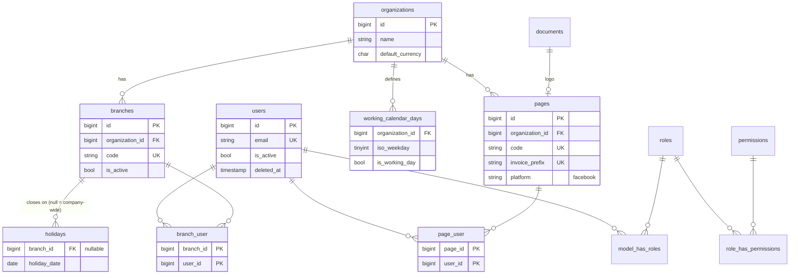
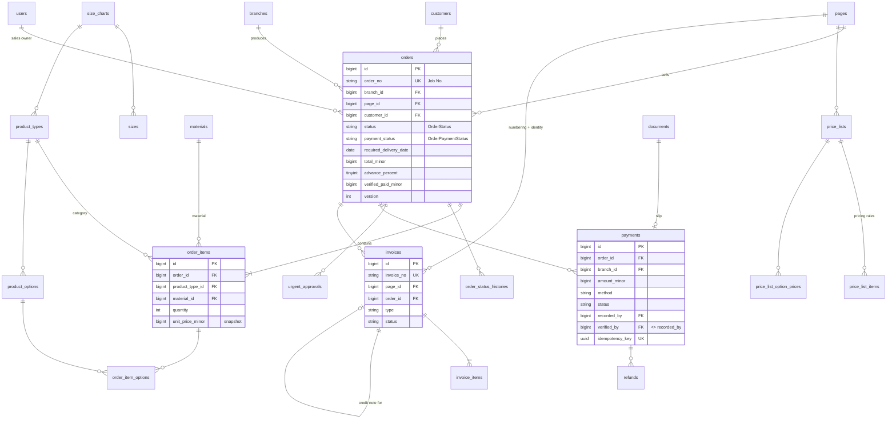
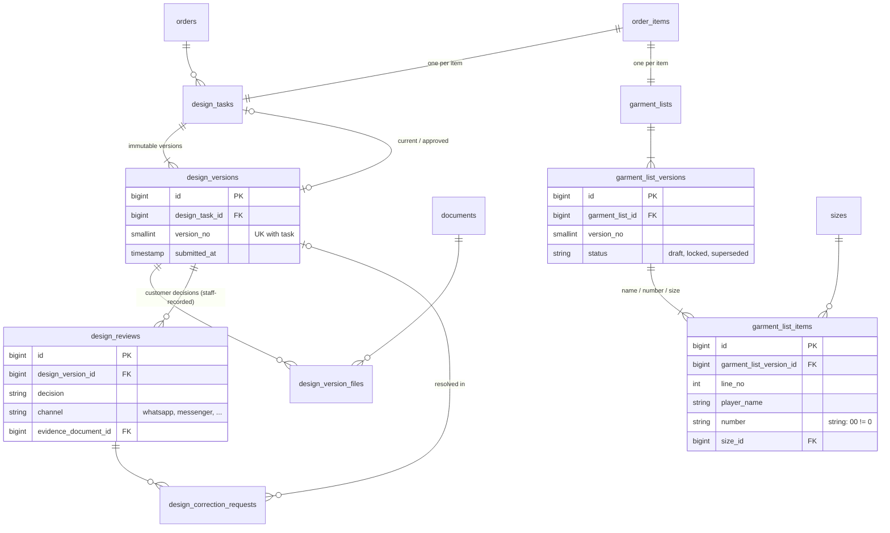
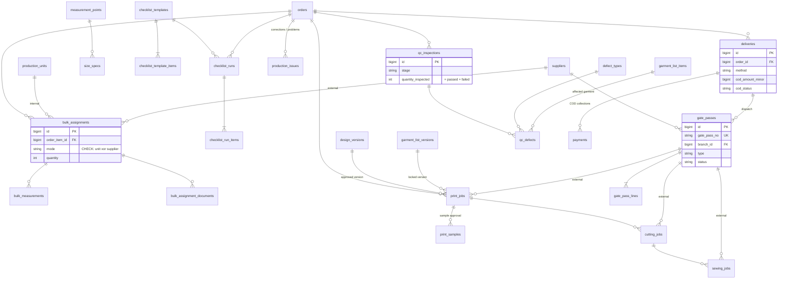
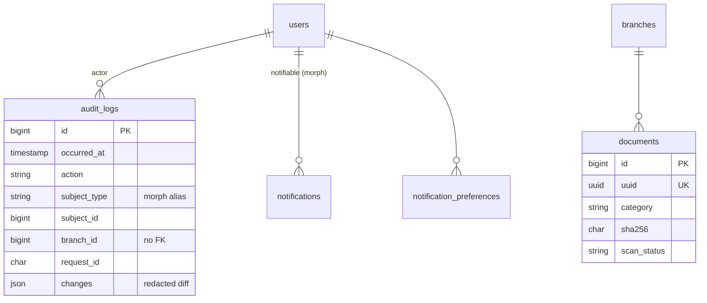

# Entity Relationship Diagram

Generated from the Phase 01 migrations (`backend/database/migrations`). Columns are abbreviated to keys and the most important attributes; see the migrations for the full definitions. Diagrams render on GitHub and in most Markdown viewers that support Mermaid.

`branch_id` on transactional tables is copied from the order when the row is created and never changes. It exists so lists can be branch-scoped without joins (DATABASE_DESIGN.md §2).

## 1. Organization, identity and scoping

## 2. Orders, pricing, payments and invoices

## 3. Design and garment lists

## 4. Production, printing, gate passes, QC and delivery

## 5. Cross-cutting

